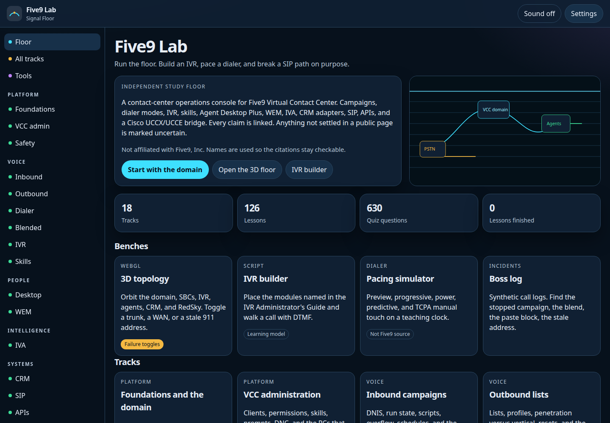
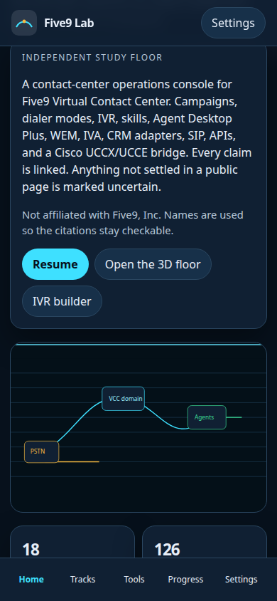
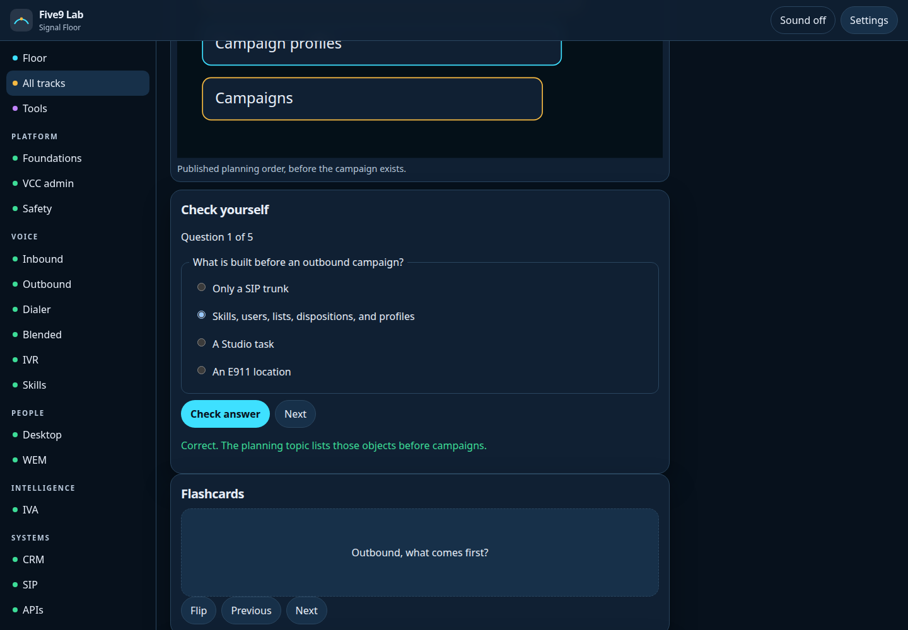
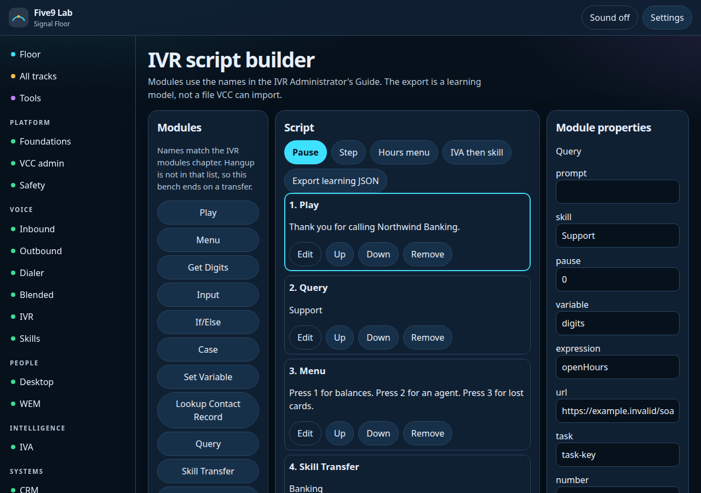
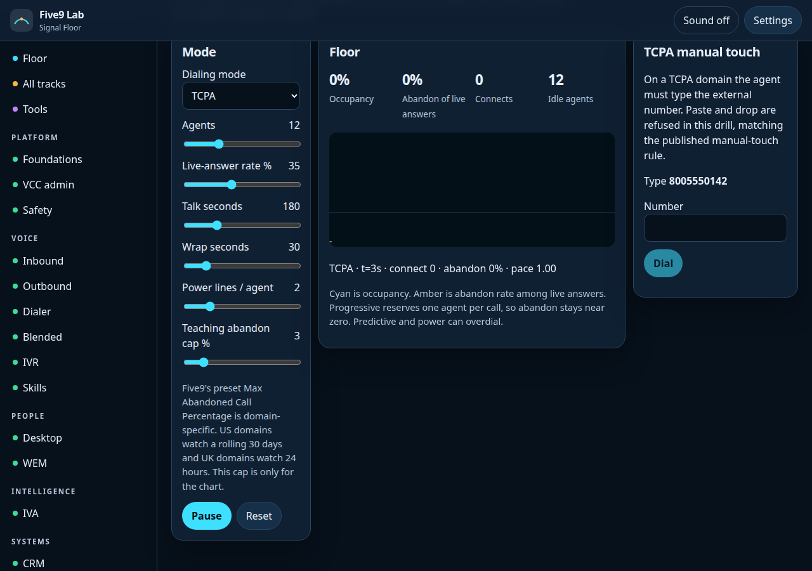
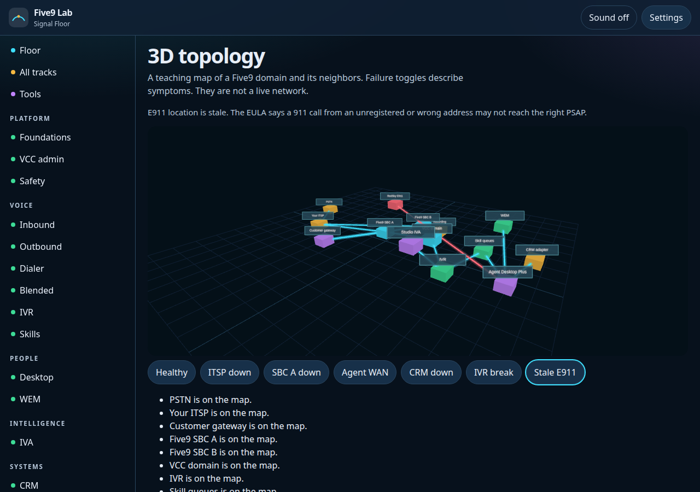

# Five9 Lab

An independent study floor for Five9 Virtual Contact Center. It walks VCC administration, inbound, outbound, and autodial campaigns, dialer modes, IVR, skills, Agent Desktop Plus, workforce engagement, IVA and GenAI Studio, CRM adapters, SIP, APIs and reporting, and a teaching bridge from Cisco UCCX and UCCE.

Five9 Lab is not affiliated with, endorsed by, or sponsored by Five9, Inc. Product behavior belongs to Five9's own documentation. When a number or a mapping might have moved, the lesson marks it uncertain.

## Run it

From the repository root:

```bash
python3 -m http.server 8741
```

Open [http://127.0.0.1:8741/campus/](http://127.0.0.1:8741/campus/). The root `index.html` redirects there. GitHub Pages can serve this tree as a static site; routing is hash-based.

Rebuild the lesson JSON after editing a track module:

```bash
python3 scripts/build_curriculum.py
node scripts/verify.mjs
```

## What you can do

- Eighteen tracks, loaded one at a time. The first paint does not download Three.js or the track files.
- Each lesson has a figure, a Play / Pause / Step / Inspect flow, a quiz, flashcards, a lab, and a fault log.
- IVR script builder. Module names follow the IVR Administrator's Guide. The export is a learning JSON, not a file VCC can import.
- Dialer pacing simulator for preview, progressive, power, predictive, and TCPA manual touch. It is a classroom clock, not the Five9 dialer.
- 3D topology with failure toggles. Reduced motion draws a flat map instead of WebGL.
- Eight boss incidents, an interview deck, a glossary, and a certification page that refuses invented exam codes.
- Settings stay in this browser: five themes (signal, paper, high contrast, amber, aurora), sound, narration with a voice list that waits for `voiceschanged` and avoids classic robotic desktop voices, speed, reduced motion, and four text sizes.

## Counts

`node scripts/verify.mjs` reports 18 tracks, 126 lessons, 630 quiz questions, 504 flashcards, 126 labs, 126 faults, 36 interview answers, 8 boss incidents, and 40 glossary rows. The shell (HTML, CSS, app script, and loaders) is 63,976 bytes. Three.js stays off the first load.

Lighthouse mobile, measured against the running lab: home performance 99 and accessibility 100. A lesson page (`#/lesson/t05/l04`) scored the same. The home view is one `h1` and about 320 DOM nodes.

## Screenshots













## License

Code is [MIT](LICENSE). Lesson content is [CC BY 4.0](https://creativecommons.org/licenses/by/4.0/). Three.js is MIT, under `campus/vendor/three/LICENSE`.
